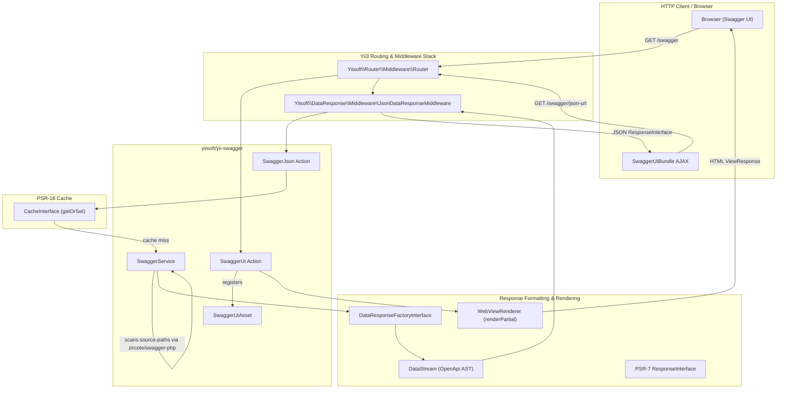

# Yii3 OpenAPI: Setup & Serving

> [!IMPORTANT]
> **Grounding rule:** sources of truth are split by question type — API: installed `vendor/yiisoft/<pkg>/src/` (versions via `composer.lock`); implementation patterns: this guide; project conventions: the project's architecture artifact or dominant `src/` style. Full table and conflict rule: SKILL.md Core rule 2.

> Part of the [OpenAPI & Swagger Guide](http-openapi-swagger.md) split — anti-patterns and related guides live there.

## 1. Overview & Architecture

The `yiisoft/yii-swagger` package provides OpenAPI v3 specification generation and interactive Swagger UI rendering for Yii 3 applications. Unlike legacy frameworks that relied on runtime reflection hacks or docblock parsing, Yii 3 pairs native PHP 8 attributes with [zircote/swagger-php](https://github.com/zircote/swagger-php) (composer constraint `^5.0`) and client assets from [swagger-api/swagger-ui](https://swagger.io/tools/swagger-ui/).

### 1.1. Core Architectural Components

| Component / FQCN | Role | Responsibilities |
|---|---|---|
| `Yiisoft\Yii\Swagger\Service\SwaggerService` | Specification Generator | Scans configured directories (`source-paths`), resolves path aliases via `Yiisoft\Aliases\Aliases`, configures `OpenApi\Generator`, validates the AST, and builds the `OpenApi\Annotations\OpenApi` document tree. Throws `InvalidArgumentException` on empty paths and `RuntimeException` if no OpenAPI target is configured. |
| `Yiisoft\Yii\Swagger\Action\SwaggerJson` | JSON Action Handler | PSR-15 `Psr\Http\Server\RequestHandlerInterface` serving the compiled OpenAPI specification. Produces a PSR-7 `ResponseInterface` containing a lazy `DataStream($openApi)` via `Yiisoft\DataResponse\ResponseFactory\DataResponseFactoryInterface`. Supports PSR-16 caching. |
| `Yiisoft\Yii\Swagger\Action\SwaggerUi` | UI Action Handler | PSR-15 `Psr\Http\Server\RequestHandlerInterface` rendering the HTML Swagger UI page via `Yiisoft\Yii\View\Renderer\WebViewRenderer`. Registers `SwaggerUiAsset` client scripts and merges browser UI options. Returns a native PSR-7 `ResponseInterface` (`ViewResponse`). |
| `Yiisoft\Yii\Swagger\Asset\SwaggerUiAsset` | Asset Bundle | Extends `Yiisoft\Assets\AssetBundle`. Publishes CSS (`swagger-ui.css`) and JavaScript (`swagger-ui-bundle.js`, `swagger-ui-standalone-preset.js`) from `@vendor/swagger-api/swagger-ui/dist` to public `@assets`. |
| `Yiisoft\Yii\Swagger\Formatter\ParamsFormatter` | Browser Option Formatter | Helper converting nested PHP UI options into JavaScript syntax for client-side `SwaggerUIBundle(...)` initialization. |

### 1.2. Architecture & Data Flow Diagram



---

## 2. Installation & Dependency Protocol

### 2.1. Core Package Installation

Install `yiisoft/yii-swagger` using Composer:

```bash
composer require yiisoft/yii-swagger
```

This package automatically pulls `zircote/swagger-php` (attribute extraction engine) and `swagger-api/swagger-ui` (client-side CSS/JS bundles).

### 2.2. Web, Presentation & Companion Packages

In production Yii 3 applications, Swagger integration interacts with several foundational ecosystem packages. Verify they are declared in your application's `composer.json`:

```bash
# Web, response handling, views, and asset management
composer require yiisoft/data-response yiisoft/view yiisoft/yii-view-renderer yiisoft/assets yiisoft/router

# DTO validation and HTTP input mapping (for documented request schemas)
composer require yiisoft/validator yiisoft/input-http yiisoft/hydrator
```

---

## 3. Built-in DI Configuration & `params.php`

### 3.1. Zero-Boilerplate DI Architecture (`di-web.php`)

`yiisoft/yii-swagger` ships with a built-in container definition file (`config/di-web.php`) registered via `yiisoft/config`.

```php
// vendor/yiisoft/yii-swagger/config/di-web.php
return [
    SwaggerService::class => [
        'withOptions()' => [
            $params['yiisoft/yii-swagger']['options'],
        ],
    ],
    SwaggerUi::class => [
        '__construct()' => [
            'params' => $params['yiisoft/yii-swagger']['ui-params'],
        ],
    ],
    SwaggerJson::class => static function (
        CacheInterface $cache,
        DataResponseFactoryInterface $responseFactory,
        SwaggerService $swaggerService,
    ) use ($params) {
        $params = $params['yiisoft/yii-swagger'];
        $swaggerJson = new SwaggerJson($cache, $responseFactory, $swaggerService);

        if (\array_key_exists('cacheTTL', $params)) {
            $swaggerJson = $swaggerJson->withCache($params['cacheTTL']);
        }

        return $swaggerJson->withPaths(...$params['source-paths']);
    },
];
```

> [!IMPORTANT]
> **Zero Manual DI Wiring:** Never write custom DI factories for `SwaggerService`, `SwaggerJson`, or `SwaggerUi` in your application's `config/common/di/swagger.php`. All dependencies and parameter bindings are wired automatically. All customizations must be done through `config/params.php` or route modifiers. **Single exception:** if you need custom OpenAPI processors, inject a pre-configured `OpenApi\Generator` into `SwaggerService` via a container definition (see §3.3).

### 3.2. Comprehensive Parameters Configuration

Configure Swagger in `config/params.php` (or environment-specific files like `config/web/params.php`):

```php
declare(strict_types=1);

return [
    'yiisoft/yii-swagger' => [
        // Source directories scanned for OpenAPI PHP 8 attributes
        'source-paths' => [
            '@src/Presentation/Action',
            '@src/Application/DTO',
            '@src/Domain',
        ],

        // Swagger UI browser options (passed directly to SwaggerUIBundle in browser)
        'ui-params' => [
            'persistAuthorization' => true,     // Retains Bearer token on browser refresh
            'displayRequestDuration' => true,   // Displays execution time in milliseconds
            'filter' => true,                   // Filter input box for tags/endpoints
            'deepLinking' => true,              // Deep linking for tags and operations
            'tryItOutEnabled' => true,          // Expands "Try it out" section by default
            'docExpansion' => 'list',           // 'none' (collapsed), 'list' (expanded tags), 'full'
            'defaultModelsExpandDepth' => 1,    // Model expansion depth in Schemas section
            'showExtensions' => true,           // Renders x- vendor extensions
        ],

        // Generator options passed to OpenApi\Generator
        'options' => [
            'aliases' => [],
            'namespaces' => [],
            'config' => [],
            'validate' => true,
            'version' => null,
        ],

        // Conditional Caching:
        // NEVER set 'cacheTTL' => null in development (causes infinite caching)!
        // Only include the 'cacheTTL' key in production environments.
        ...($_ENV['APP_ENV'] === 'prod' ? ['cacheTTL' => 86400] : []),
    ],
];
```

### 3.3. Generator Scanner Options (7 Supported Options)

The `'options'` array in `params.php` is injected into `SwaggerService::withOptions(array $options)`. `SwaggerService::fetch()` evaluates exactly **7 options**:

| Option Key | Type | Default | Description |
|---|---|---|---|
| `'version'` | `string\|null` | `null` | Target OpenAPI specification version string (e.g., `'3.0.0'` or `'3.1.0'`). Passed to `Generator::setVersion()`. |
| `'validate'` | `bool` | `true` | When `true`, validates the generated OpenAPI AST against OpenAPI schemas during generation. |
| `'config'` | `array<string, mixed>` | `[]` | Associative array of configuration options passed to `Generator::setConfig()`. Must not be a list array. |
| `'aliases'` | `array<string, string>` | `[]` | Map of custom attribute/annotation aliases passed to `Generator::setAliases()`. |
| `'namespaces'` | `string[]` | `[]` | List of namespace prefixes passed to `Generator::setNamespaces()` for selective class analysis. |
| `'analysis'` | `OpenApi\Analysis\|null` | `null` | Pre-initialized `Analysis` instance passed to `Generator::generate($directories, $analysis, $validate)`. |
| `'analyser'` | `OpenApi\Analysers\AnalyserInterface\|null` | `null` | Custom AST analyser passed to `Generator::setAnalyser()`. |

> [!WARNING]
> The option `'processors'` is **not** supported by `SwaggerService::createGenerator()`. If you need custom OpenAPI processors, inject a pre-configured `OpenApi\Generator` instance into `SwaggerService` via container definition in `config/common/di/swagger.php`.

### 3.4. Mandatory Path Aliases for Static Asset Publishing

`SwaggerUiAsset` publishes CSS and JS bundles to the web root. Ensure the required path aliases are declared in `config/params.php` or `config/common/aliases.php`:

```php
declare(strict_types=1);

return [
    'yiisoft/aliases' => [
        'aliases' => [
            '@root' => dirname(__DIR__),
            '@src' => '@root/src',
            '@views' => '@root/views',
            '@public' => '@root/public',
            '@assets' => '@public/assets',     // Writable filesystem directory for assets
            '@assetsUrl' => '/assets',          // Web-accessible URL prefix for assets
        ],
    ],
];
```

> [!CAUTION]
> If `@assets` or `@assetsUrl` is missing or undefined, `Yiisoft\Assets\AssetPublisher` will throw an `InvalidArgumentException: Invalid path alias: @assets`, causing Swagger UI to render a broken white page.

---

## 4. Route Integration & Serving Documentation

### 4.1. Route Group Registration

Register Swagger routes in `config/web/routes.php`:

```php
declare(strict_types=1);

use Yiisoft\DataResponse\Middleware\JsonDataResponseMiddleware;
use Yiisoft\Router\Group;
use Yiisoft\Router\Route\Get;
use Yiisoft\Yii\Swagger\Action\SwaggerJson;
use Yiisoft\Yii\Swagger\Action\SwaggerUi;

return [
    (new Group('/swagger'))->routes(
        // 1. Swagger UI HTML Viewer
        (new Get(''))
            ->action(static fn (SwaggerUi $swaggerUi): SwaggerUi => $swaggerUi->withJsonUrl('/swagger/json-url'))
            ->name('swagger.ui'),

        // 2. OpenAPI JSON Specification Endpoint
        (new Get('/json-url'))
            ->middleware(JsonDataResponseMiddleware::class)
            ->action(SwaggerJson::class)
            ->name('swagger.json'),
    ),
];
```

Alternatively, you can use the direct constructor:

```php
return [
    new Group('/swagger', [
        (new Get(''))
            ->action(static fn (SwaggerUi $swaggerUi): SwaggerUi => $swaggerUi->withJsonUrl('/swagger/json-url'))
            ->name('swagger.ui'),
        (new Get('/json-url'))
            ->middleware(JsonDataResponseMiddleware::class)
            ->action(SwaggerJson::class)
            ->name('swagger.json'),
    ]),
];
```

### 4.2. Why `Group::create('/swagger', [...])` Silently Fails

> [!CAUTION]
> `Group::create(?string $prefix = null)` accepts **only the prefix** — a second argument (routes array) is silently discarded by PHP, leaving an empty route group with zero endpoints. Always use `new Group('/swagger', [...])` or `(new Group('/swagger'))->routes(...)`. The canonical trap analysis lives in the [Routing Guide, §9 Anti-Pattern Matrix](http-routes.md#9-anti-pattern-matrix).

### 4.3. The JSON Response Middleware Contract

`SwaggerJson::handle()` executes:

```php
return $this->responseFactory->createResponse($openApi);
```

In `yiisoft/data-response`, `DataResponseFactoryInterface::createResponse()` wraps `$openApi` inside a lazy `DataStream`. 

- To emit valid JSON, the route **must** have `Yiisoft\DataResponse\Middleware\JsonDataResponseMiddleware::class` attached.
- If this middleware is missing, attempting to read the response stream during HTTP emission will throw:
  ```
  LogicException: Formatter is not set.
  ```
- **Deprecation Note:** Legacy `Yiisoft\DataResponse\Middleware\FormatDataResponseAsJson` is deprecated. Always use `JsonDataResponseMiddleware::class`.

### 4.4. Swagger UI Route & Redundant HTML Middleware Removal

`SwaggerUi::handle()` delegates directly to `WebViewRenderer::renderPartial()`, which returns a native PSR-7 `ResponseInterface` (`ViewResponse`), **not** a `DataResponse`.

Attaching `FormatDataResponseAsHtml::class` to the `SwaggerUi` route is completely redundant because that middleware checks `$response instanceof DataResponse` and ignores standard (non-`DataResponse`) responses. Omit it entirely from the Swagger UI route.

---
