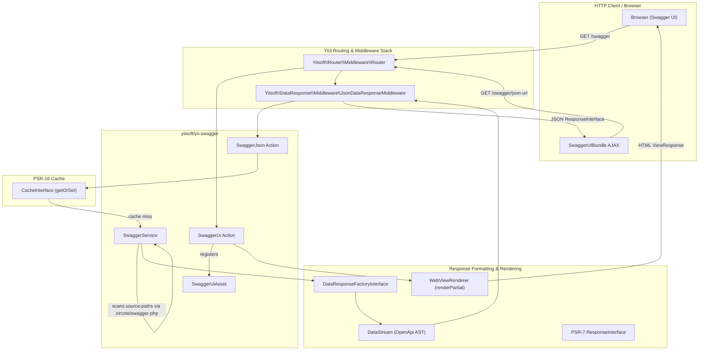

# Yii3 OpenAPI & Swagger Integration Guide

> [!IMPORTANT]
> **Grounding rule:** this guide is authoring synthesis for navigation and patterns. The source of truth for every class name, method signature, constructor argument, and configuration key is the installed package source under `vendor/yiisoft/<pkg>/src/`. Verify there before writing code; never substitute this guide for vendor sources, and never write Yii 2 APIs.

> Comprehensive architectural and usage guide for `yiisoft/yii-swagger`: generating OpenAPI v3 specifications from PHP 8 attributes (`zircote/swagger-php`), serving interactive Swagger UI documentation, configuring performance caching, managing multi-version APIs, and securing documentation endpoints in Yii 3 applications.

---

## Table of Contents
- [1. Overview & Architecture](#1-overview--architecture)
  - [1.1. Core Architectural Components](#11-core-architectural-components)
  - [1.2. Architecture & Data Flow Diagram](#12-architecture--data-flow-diagram)
- [2. Installation & Dependency Protocol](#2-installation--dependency-protocol)
  - [2.1. Core Package Installation](#21-core-package-installation)
  - [2.2. Web, Presentation & Companion Packages](#22-web-presentation--companion-packages)
- [3. Built-in DI Configuration & `params.php`](#3-built-in-di-configuration--paramsphp)
  - [3.1. Zero-Boilerplate DI Architecture (`di-web.php`)](#31-zero-boilerplate-di-architecture-di-webphp)
  - [3.2. Comprehensive Parameters Configuration](#32-comprehensive-parameters-configuration)
  - [3.3. Generator Scanner Options (7 Supported Options)](#33-generator-scanner-options-7-supported-options)
  - [3.4. Mandatory Path Aliases for Static Asset Publishing](#34-mandatory-path-aliases-for-static-asset-publishing)
- [4. Route Integration & Serving Documentation](#4-route-integration--serving-documentation)
  - [4.1. Route Group Registration](#41-route-group-registration)
  - [4.2. Why `Group::create('/swagger', [...])` Silently Fails](#42-why-groupcreateswagger--silently-fails)
  - [4.3. The JSON Response Middleware Contract](#43-the-json-response-middleware-contract)
  - [4.4. Swagger UI Route & Redundant HTML Middleware Removal](#44-swagger-ui-route--redundant-html-middleware-removal)
- [5. Documenting API Endpoints with PHP 8 Attributes](#5-documenting-api-endpoints-with-php-8-attributes)
  - [5.1. Global API Information & Tags](#51-global-api-information--tags)
  - [5.2. Security Schemes (Bearer JWT, API Key, OAuth 2.0)](#52-security-schemes-bearer-jwt-api-key-oauth-20)
  - [5.3. Endpoint Actions & CRUD Operations (Get, Post, Put, Patch, Delete)](#53-endpoint-actions--crud-operations-get-post-put-patch-delete)
  - [5.4. Route Parameters: Injecting `CurrentRoute` vs Broken PSR-7 Attributes](#54-route-parameters-injecting-currentroute-vs-broken-psr-7-attributes)
  - [5.5. Query & Header Parameters](#55-query--header-parameters)
  - [5.6. DTO Schemas & Dual Attributes (OpenAPI + `yiisoft/validator`)](#56-dto-schemas--dual-attributes-openapi--yiisoftvalidator)
  - [5.7. File Uploads (`multipart/form-data`)](#57-file-uploads-multipartform-data)
  - [5.8. Standardized Error Models: RFC 7807 / RFC 9457 Problem Details](#58-standardized-error-models-rfc-7807--rfc-9457-problem-details)
- [6. Multi-Version API Documentation (`/swagger/v1` & `/swagger/v2`)](#6-multi-version-api-documentation-swaggerv1--swaggerv2)
- [7. Offline CLI Specification Generator](#7-offline-cli-specification-generator)
- [8. Swagger UI Customization & Asset Management](#8-swagger-ui-customization--asset-management)
  - [8.1. UI Configuration Parameters (`ui-params`)](#81-ui-configuration-parameters-ui-params)
  - [8.2. Customizing the HTML View Template via `Theme::$pathMap`](#82-customizing-the-html-view-template-via-themepathmap)
  - [8.3. Custom CSS Theme & Dark Mode](#83-custom-css-theme--dark-mode)
  - [8.4. CDN Asset Serving for Serverless Deployments](#84-cdn-asset-serving-for-serverless-deployments)
- [9. Environment Protection & Performance Caching](#9-environment-protection--performance-caching)
  - [9.1. Caching Mechanics & The Infinite Dev Cache Trap](#91-caching-mechanics--the-infinite-dev-cache-trap)
  - [9.2. Conditional Production Caching Configuration](#92-conditional-production-caching-configuration)
  - [9.3. Restricting Access in Production (IP Filtering & Authentication)](#93-restricting-access-in-production-ip-filtering--authentication)
  - [9.4. Cache Invalidation Strategies](#94-cache-invalidation-strategies)
- [10. Anti-Patterns & Common Traps](#10-anti-patterns--common-traps)
- [11. Related Topic Guides](#11-related-topic-guides)

---

## 1. Overview & Architecture

The `yiisoft/yii-swagger` package provides OpenAPI v3 specification generation and interactive Swagger UI rendering for Yii 3 applications. Unlike legacy frameworks that relied on runtime reflection hacks or docblock parsing, Yii 3 pairs native PHP 8 attributes with [zircote/swagger-php](https://github.com/zircote/swagger-php) (v5+) and client assets from [swagger-api/swagger-ui](https://swagger.io/tools/swagger-ui/).

### 1.1. Core Architectural Components

| Component / FQCN | Role | Responsibilities |
|---|---|---|
| `Yiisoft\Yii\Swagger\Service\SwaggerService` | Specification Generator | Scans configured directories (`source-paths`), resolves path aliases via `Yiisoft\Aliases\Aliases`, configures `OpenApi\Generator`, validates the AST, and builds the `OpenApi\Annotations\OpenApi` document tree. Throws `InvalidArgumentException` on empty paths and `RuntimeException` if no OpenAPI target is configured. |
| `Yiisoft\Yii\Swagger\Action\SwaggerJson` | JSON Action Handler | PSR-15 `Psr\Http\Server\RequestHandlerInterface` serving the compiled OpenAPI specification. Produces a PSR-7 `ResponseInterface` containing a lazy `DataStream($openApi)` via `Yiisoft\DataResponse\ResponseFactory\DataResponseFactoryInterface`. Supports PSR-16 caching. |
| `Yiisoft\Yii\Swagger\Action\SwaggerUi` | UI Action Handler | PSR-15 `Psr\Http\Server\RequestHandlerInterface` rendering the HTML Swagger UI page via `Yiisoft\Yii\View\Renderer\WebViewRenderer`. Registers `SwaggerUiAsset` client scripts and merges browser UI options. Returns a native PSR-7 `ResponseInterface` (`ViewResponse`). |
| `Yiisoft\Yii\Swagger\Asset\SwaggerUiAsset` | Asset Bundle | Extends `Yiisoft\Assets\AssetBundle`. Publishes CSS (`swagger-ui.css`) and JavaScript (`swagger-ui-bundle.js`, `swagger-ui-standalone-preset.js`) from `@vendor/swagger-api/swagger-ui/dist` to public `@assets`. |
| `Yiisoft\Yii\Swagger\Formatter\ParamsFormatter` | Browser Option Formatter | Helper converting nested PHP UI options into JavaScript syntax for client-side `SwaggerUIBundle(...)` initialization. |

### 1.2. Architecture & Data Flow Diagram



---

## 2. Installation & Dependency Protocol

### 2.1. Core Package Installation

Install `yiisoft/yii-swagger` using Composer:

```bash
composer require yiisoft/yii-swagger
```

This package automatically pulls `zircote/swagger-php` (attribute extraction engine) and `swagger-api/swagger-ui` (client-side CSS/JS bundles).

### 2.2. Web, Presentation & Companion Packages

In production Yii 3 applications, Swagger integration interacts with several foundational ecosystem packages. Verify they are declared in your application's `composer.json`:

```bash
# Web, response handling, views, and asset management
composer require yiisoft/data-response yiisoft/view yiisoft/yii-view-renderer yiisoft/assets yiisoft/router

# DTO validation and HTTP input mapping (for documented request schemas)
composer require yiisoft/validator yiisoft/input-http yiisoft/hydrator
```

---

## 3. Built-in DI Configuration & `params.php`

### 3.1. Zero-Boilerplate DI Architecture (`di-web.php`)

`yiisoft/yii-swagger` ships with a built-in container definition file (`config/di-web.php`) registered via `yiisoft/config`.

```php
// vendor/yiisoft/yii-swagger/config/di-web.php
return [
    SwaggerService::class => [
        'withOptions()' => [
            $params['yiisoft/yii-swagger']['options'],
        ],
    ],
    SwaggerUi::class => [
        '__construct()' => [
            'params' => $params['yiisoft/yii-swagger']['ui-params'],
        ],
    ],
    SwaggerJson::class => static function (
        CacheInterface $cache,
        DataResponseFactoryInterface $responseFactory,
        SwaggerService $swaggerService,
    ) use ($params) {
        $params = $params['yiisoft/yii-swagger'];
        $swaggerJson = new SwaggerJson($cache, $responseFactory, $swaggerService);

        if (\array_key_exists('cacheTTL', $params)) {
            $swaggerJson = $swaggerJson->withCache($params['cacheTTL']);
        }

        return $swaggerJson->withPaths(...$params['source-paths']);
    },
];
```

> [!IMPORTANT]
> **Zero Manual DI Wiring:** Never write custom DI factories for `SwaggerService`, `SwaggerJson`, or `SwaggerUi` in your application's `config/web/di/swagger.php`. All dependencies and parameter bindings are wired automatically. All customizations must be done through `config/params.php` or route modifiers.

### 3.2. Comprehensive Parameters Configuration

Configure Swagger in `config/params.php` (or environment-specific files like `config/web/params.php`):

```php
declare(strict_types=1);

return [
    'yiisoft/yii-swagger' => [
        // Source directories scanned for OpenAPI PHP 8 attributes
        'source-paths' => [
            '@src/Presentation/Action',
            '@src/Application/DTO',
            '@src/Domain',
        ],

        // Swagger UI browser options (passed directly to SwaggerUIBundle in browser)
        'ui-params' => [
            'persistAuthorization' => true,     // Retains Bearer token on browser refresh
            'displayRequestDuration' => true,   // Displays execution time in milliseconds
            'filter' => true,                   // Filter input box for tags/endpoints
            'deepLinking' => true,              // Deep linking for tags and operations
            'tryItOutEnabled' => true,          // Expands "Try it out" section by default
            'docExpansion' => 'list',           // 'none' (collapsed), 'list' (expanded tags), 'full'
            'defaultModelsExpandDepth' => 1,    // Model expansion depth in Schemas section
            'showExtensions' => true,           // Renders x- vendor extensions
        ],

        // Generator options passed to OpenApi\Generator
        'options' => [
            'aliases' => [],
            'namespaces' => [],
            'config' => [],
            'validate' => true,
            'version' => null,
        ],

        // Conditional Caching:
        // NEVER set 'cacheTTL' => null in development (causes infinite caching)!
        // Only include the 'cacheTTL' key in production environments.
        ...($_ENV['APP_ENV'] === 'prod' ? ['cacheTTL' => 86400] : []),
    ],
];
```

### 3.3. Generator Scanner Options (7 Supported Options)

The `'options'` array in `params.php` is injected into `SwaggerService::withOptions(array $options)`. `SwaggerService::fetch()` evaluates exactly **7 options**:

| Option Key | Type | Default | Description |
|---|---|---|---|
| `'version'` | `string\|null` | `null` | Target OpenAPI specification version string (e.g., `'3.0.0'` or `'3.1.0'`). Passed to `Generator::setVersion()`. |
| `'validate'` | `bool` | `true` | When `true`, validates the generated OpenAPI AST against OpenAPI schemas during generation. |
| `'config'` | `array<string, mixed>` | `[]` | Associative array of configuration options passed to `Generator::setConfig()`. Must not be a list array. |
| `'aliases'` | `array<string, string>` | `[]` | Map of custom attribute/annotation aliases passed to `Generator::setAliases()`. |
| `'namespaces'` | `string[]` | `[]` | List of namespace prefixes passed to `Generator::setNamespaces()` for selective class analysis. |
| `'analysis'` | `OpenApi\Analysis\|null` | `null` | Pre-initialized `Analysis` instance passed to `Generator::generate($directories, $analysis, $validate)`. |
| `'analyser'` | `OpenApi\Analysers\AnalyserInterface\|null` | `null` | Custom AST analyser passed to `Generator::setAnalyser()`. |

> [!WARNING]
> The option `'processors'` is **not** supported by `SwaggerService::createGenerator()`. If you need custom OpenAPI processors, inject a pre-configured `OpenApi\Generator` instance into `SwaggerService` via container definition in `config/common/di/swagger.php`.

### 3.4. Mandatory Path Aliases for Static Asset Publishing

`SwaggerUiAsset` publishes CSS and JS bundles to the web root. Ensure the required path aliases are declared in `config/params.php` or `config/common/aliases.php`:

```php
declare(strict_types=1);

return [
    'yiisoft/aliases' => [
        'aliases' => [
            '@root' => dirname(__DIR__),
            '@src' => '@root/src',
            '@views' => '@root/views',
            '@public' => '@root/public',
            '@assets' => '@public/assets',     // Writable filesystem directory for assets
            '@assetsUrl' => '/assets',          // Web-accessible URL prefix for assets
        ],
    ],
];
```

> [!CAUTION]
> If `@assets` or `@assetsUrl` is missing or undefined, `Yiisoft\Assets\AssetPublisher` will throw an `InvalidArgumentException: Invalid path alias: @assets`, causing Swagger UI to render a broken white page.

---

## 4. Route Integration & Serving Documentation

### 4.1. Route Group Registration

Register Swagger routes in `config/web/routes.php`:

```php
declare(strict_types=1);

use Yiisoft\DataResponse\Middleware\JsonDataResponseMiddleware;
use Yiisoft\Router\Group;
use Yiisoft\Router\Route\Get;
use Yiisoft\Yii\Swagger\Action\SwaggerJson;
use Yiisoft\Yii\Swagger\Action\SwaggerUi;

return [
    (new Group('/swagger'))->routes(
        // 1. Swagger UI HTML Viewer
        (new Get(''))
            ->action(static fn (SwaggerUi $swaggerUi): SwaggerUi => $swaggerUi->withJsonUrl('/swagger/json-url'))
            ->name('swagger.ui'),

        // 2. OpenAPI JSON Specification Endpoint
        (new Get('/json-url'))
            ->middleware(JsonDataResponseMiddleware::class)
            ->action(SwaggerJson::class)
            ->name('swagger.json'),
    ),
];
```

Alternatively, you can use the direct constructor:

```php
return [
    new Group('/swagger', [
        (new Get(''))
            ->action(static fn (SwaggerUi $swaggerUi): SwaggerUi => $swaggerUi->withJsonUrl('/swagger/json-url'))
            ->name('swagger.ui'),
        (new Get('/json-url'))
            ->middleware(JsonDataResponseMiddleware::class)
            ->action(SwaggerJson::class)
            ->name('swagger.json'),
    ]),
];
```

### 4.2. Why `Group::create('/swagger', [...])` Silently Fails

> [!CAUTION]
> `Group::create(?string $prefix = null)` accepts **only the prefix** — a second argument (routes array) is silently discarded by PHP, leaving an empty route group with zero endpoints. Always use `new Group('/swagger', [...])` or `(new Group('/swagger'))->routes(...)`. The canonical trap analysis lives in the [Routing Guide, §9 Anti-Pattern Matrix](http-routes.md#9-anti-pattern-matrix).

### 4.3. The JSON Response Middleware Contract

`SwaggerJson::handle()` executes:

```php
return $this->responseFactory->createResponse($openApi);
```

In `yiisoft/data-response`, `DataResponseFactoryInterface::createResponse()` wraps `$openApi` inside a lazy `DataStream`. 

- To emit valid JSON, the route **must** have `Yiisoft\DataResponse\Middleware\JsonDataResponseMiddleware::class` attached.
- If this middleware is missing, attempting to read the response stream during HTTP emission will throw:
  ```
  LogicException: Formatter is not set.
  ```
- **Deprecation Note:** Legacy `Yiisoft\DataResponse\Middleware\FormatDataResponseAsJson` is deprecated. Always use `JsonDataResponseMiddleware::class`.

### 4.4. Swagger UI Route & Redundant HTML Middleware Removal

`SwaggerUi::handle()` delegates directly to `WebViewRenderer::renderPartial()`, which returns a native PSR-7 `ResponseInterface` (`ViewResponse`), **not** a `DataResponse`.

Attaching `FormatDataResponseAsHtml::class` to the `SwaggerUi` route is completely redundant because that middleware checks `$response instanceof DataResponse` and ignores standard (non-`DataResponse`) responses. Omit it entirely from the Swagger UI route.

---

## 5. Documenting API Endpoints with PHP 8 Attributes

Yii 3 leverages PHP 8 attributes from `zircote/swagger-php` (`OpenApi\Attributes`, aliased as `OA`).

### 5.1. Global API Information & Tags

Define application-wide OpenAPI metadata on a central, uninstantiated class (e.g., `App\Presentation\Action\Api\ApiDoc`):

```php
declare(strict_types=1);

namespace App\Presentation\Action\Api;

use OpenApi\Attributes as OA;

#[OA\Info(
    version: '1.0.0',
    title: 'Acme E-Commerce REST API',
    description: 'High-performance headless API built with Yii 3 Framework.',
    termsOfService: 'https://example.com/terms',
    contact: new OA\Contact(
        name: 'API Platform Engineering',
        url: 'https://example.com/support',
        email: 'api-support@example.com'
    ),
    license: new OA\License(
        name: 'MIT License',
        url: 'https://opensource.org/licenses/MIT'
    )
)]
#[OA\Server(
    url: '/',
    description: 'Current Environment Relative Gateway'
)]
#[OA\Tag(
    name: 'Products',
    description: 'Product catalog query and mutation operations'
)]
#[OA\Tag(
    name: 'Orders',
    description: 'Customer order placement and lifecycle management'
)]
final class ApiDoc
{
}
```

> [!TIP]
> Always set `#[OA\Server(url: '/')]`. Using relative server URLs ensures that "Try it out" works seamlessly in local development (`localhost:8080`), staging environments, and production domains without editing configuration files.

### 5.2. Security Schemes (Bearer JWT, API Key, OAuth 2.0)

Declare all security schemes supported by your application in `ApiDoc`:

```php
declare(strict_types=1);

namespace App\Presentation\Action\Api;

use OpenApi\Attributes as OA;

// 1. HTTP Bearer Token (JWT)
#[OA\SecurityScheme(
    securityScheme: 'bearerAuth',
    type: 'http',
    scheme: 'bearer',
    bearerFormat: 'JWT',
    description: 'Enter your JWT access token as: Bearer <token>'
)]

// 2. API Key via Request Header
#[OA\SecurityScheme(
    securityScheme: 'apiKeyHeader',
    type: 'apiKey',
    in: 'header',
    name: 'X-API-KEY',
    description: 'Client application secret key'
)]

// 3. API Key via Query Parameter
#[OA\SecurityScheme(
    securityScheme: 'apiKeyQuery',
    type: 'apiKey',
    in: 'query',
    name: 'api_key',
    description: 'API key for third-party webhook callbacks'
)]

// 4. OAuth 2.0 Authorization Code & Client Credentials Flows
#[OA\SecurityScheme(
    securityScheme: 'oauth2',
    type: 'oauth2',
    description: 'OAuth 2.0 authentication provider',
    flows: new OA\Flows(
        authorizationCode: new OA\Flow(
            authorizationUrl: 'https://auth.example.com/oauth/authorize',
            tokenUrl: 'https://auth.example.com/oauth/token',
            refreshUrl: 'https://auth.example.com/oauth/token/refresh',
            scopes: [
                'read:products' => 'Read catalog products',
                'write:products' => 'Manage product records',
                'orders:create' => 'Place new customer orders',
            ]
        ),
        clientCredentials: new OA\Flow(
            tokenUrl: 'https://auth.example.com/oauth/token',
            scopes: [
                'service:sync' => 'Machine-to-machine catalog synchronization',
            ]
        )
    )
)]
final class SecurityDoc
{
}
```

### 5.3. Endpoint Actions & CRUD Operations (Get, Post, Put, Patch, Delete)

Yii 3 strongly recommends single-action invokable controllers (`__invoke`).

#### 5.3.1. GET Endpoint (Retrieving Single Resource)

```php
declare(strict_types=1);

namespace App\Presentation\Action\Product;

use App\Domain\Product\ProductRepositoryInterface;
use OpenApi\Attributes as OA;
use Psr\Http\Message\ResponseInterface;
use Yiisoft\DataResponse\ResponseFactory\DataResponseFactoryInterface;
use Yiisoft\Http\Status;
use Yiisoft\Router\CurrentRoute;

use function sprintf;

final readonly class GetProductAction
{
    public function __construct(
        private ProductRepositoryInterface $productRepository,
        private DataResponseFactoryInterface $responseFactory,
    ) {}

    #[OA\Get(
        path: '/api/v1/products/{id}',
        summary: 'Fetch product details',
        description: 'Returns complete product entity with pricing and stock metadata.',
        tags: ['Products'],
        security: [['bearerAuth' => []]],
        parameters: [
            new OA\Parameter(
                name: 'id',
                in: 'path',
                required: true,
                description: 'Unique product UUID identifier',
                schema: new OA\Schema(type: 'string', format: 'uuid', example: 'a0eebc99-9c0b-4ef8-bb6d-6bb9bd380a11')
            ),
        ],
        responses: [
            new OA\Response(
                response: Status::OK,
                description: 'Product retrieved successfully',
                content: new OA\JsonContent(ref: '#/components/schemas/ProductResponse')
            ),
            new OA\Response(
                response: Status::NOT_FOUND,
                description: 'Product with specified ID not found',
                content: new OA\JsonContent(ref: '#/components/schemas/ProblemDetails')
            ),
            new OA\Response(
                response: Status::UNAUTHORIZED,
                description: 'Authentication token missing or invalid'
            ),
        ]
    )]
    public function __invoke(CurrentRoute $currentRoute): ResponseInterface
    {
        $id = $currentRoute->getArgument('id');
        if ($id === null) {
            return $this->responseFactory->createResponse(
                ['title' => 'Missing product ID in route', 'status' => Status::BAD_REQUEST],
                Status::BAD_REQUEST
            );
        }

        $product = $this->productRepository->findById($id);
        if ($product === null) {
            return $this->responseFactory->createResponse(
                [
                    'type' => 'https://example.com/errors/not-found',
                    'title' => 'Product Not Found',
                    'status' => Status::NOT_FOUND,
                    'detail' => sprintf('Product with ID "%s" does not exist.', $id),
                ],
                Status::NOT_FOUND
            );
        }

        return $this->responseFactory->createResponse([
            'id' => $product->getId(),
            'sku' => $product->getSku(),
            'title' => $product->getTitle(),
            'price' => $product->getPrice(),
            'stock' => $product->getStock(),
        ]);
    }
}
```

#### 5.3.2. DELETE Endpoint

```php
declare(strict_types=1);

namespace App\Presentation\Action\Product;

use App\Domain\Product\ProductRepositoryInterface;
use OpenApi\Attributes as OA;
use Psr\Http\Message\ResponseInterface;
use Yiisoft\DataResponse\ResponseFactory\DataResponseFactoryInterface;
use Yiisoft\Http\Status;
use Yiisoft\Router\CurrentRoute;

final readonly class DeleteProductAction
{
    public function __construct(
        private ProductRepositoryInterface $productRepository,
        private DataResponseFactoryInterface $responseFactory,
    ) {}

    #[OA\Delete(
        path: '/api/v1/products/{id}',
        summary: 'Delete product',
        tags: ['Products'],
        security: [['bearerAuth' => []]],
        parameters: [
            new OA\Parameter(
                name: 'id',
                in: 'path',
                required: true,
                schema: new OA\Schema(type: 'string', format: 'uuid')
            ),
        ],
        responses: [
            new OA\Response(
                response: Status::NO_CONTENT,
                description: 'Product deleted successfully'
            ),
            new OA\Response(
                response: Status::NOT_FOUND,
                description: 'Product not found',
                content: new OA\JsonContent(ref: '#/components/schemas/ProblemDetails')
            ),
        ]
    )]
    public function __invoke(CurrentRoute $currentRoute): ResponseInterface
    {
        $id = (string) $currentRoute->getArgument('id');
        $this->productRepository->delete($id);

        return $this->responseFactory->createResponse(null, Status::NO_CONTENT);
    }
}
```

### 5.4. Route Parameters: Injecting `CurrentRoute` vs Broken PSR-7 Attributes

> [!CAUTION]
> **Fatal Routing Trap:** route match arguments (e.g. `{id}`, `{slug}`) are stored in `Yiisoft\Router\CurrentRoute`, not in PSR-7 request attributes — `$request->getAttribute('id')` always evaluates to `null`. See the [Routing Guide, Trap 1](http-routes.md).

Always inject `Yiisoft\Router\CurrentRoute` into action methods or constructor:

```php
// CORRECT (Yii 3 idiomatic):
public function __invoke(CurrentRoute $currentRoute): ResponseInterface
{
    $id = $currentRoute->getArgument('id');
    // ...
}

// ALSO CORRECT (via Hydrator parameter attribute):
use Yiisoft\Router\HydratorAttribute\RouteArgument;

public function __invoke(#[RouteArgument('id')] string $id): ResponseInterface
{
    // ...
}

// WRONG (will be null):
public function __invoke(ServerRequestInterface $request): ResponseInterface
{
    $id = $request->getAttribute('id'); // NULL!
}
```

### 5.5. Query & Header Parameters

```php
declare(strict_types=1);

namespace App\Presentation\Action\Product;

use OpenApi\Attributes as OA;

#[OA\Get(
    path: '/api/v1/products',
    summary: 'Search & filter product catalog',
    tags: ['Products'],
    parameters: [
        new OA\Parameter(
            name: 'query',
            in: 'query',
            required: false,
            description: 'Full-text search keywords',
            schema: new OA\Schema(type: 'string')
        ),
        new OA\Parameter(
            name: 'category_id',
            in: 'query',
            required: false,
            description: 'Filter by category UUID',
            schema: new OA\Schema(type: 'string', format: 'uuid')
        ),
        new OA\Parameter(
            name: 'page',
            in: 'query',
            required: false,
            description: '1-based pagination page number',
            schema: new OA\Schema(type: 'integer', default: 1, minimum: 1)
        ),
        new OA\Parameter(
            name: 'limit',
            in: 'query',
            required: false,
            description: 'Records per page',
            schema: new OA\Schema(type: 'integer', default: 20, minimum: 1, maximum: 100)
        ),
        new OA\Parameter(
            name: 'X-Client-Locale',
            in: 'header',
            required: false,
            description: 'Client preferred language (ISO 639-1)',
            schema: new OA\Schema(type: 'string', default: 'en')
        ),
    ],
    responses: [
        new OA\Response(
            response: 200,
            description: 'Paginated product list',
            content: new OA\JsonContent(
                properties: [
                    new OA\Property(
                        property: 'items',
                        type: 'array',
                        items: new OA\Items(ref: '#/components/schemas/ProductResponse')
                    ),
                    new OA\Property(
                        property: 'pagination',
                        properties: [
                            new OA\Property(property: 'page', type: 'integer', example: 1),
                            new OA\Property(property: 'limit', type: 'integer', example: 20),
                            new OA\Property(property: 'total', type: 'integer', example: 145),
                        ]
                    ),
                ]
            )
        ),
    ]
)]
final readonly class ListProductsAction
{
    // ...
}
```

### 5.6. DTO Schemas & Dual Attributes (OpenAPI + `yiisoft/validator`)

Yii 3 applications achieve clean single-source-of-truth DTOs by pairing `OpenApi\Attributes` with `Yiisoft\Validator\Rule\*` attributes on constructor-promoted properties.

#### 5.6.1. BackedEnum for Type Safety

```php
declare(strict_types=1);

namespace App\Domain\Product;

enum ProductStatus: string
{
    case DRAFT = 'draft';
    case ACTIVE = 'active';
    case ARCHIVED = 'archived';
}
```

#### 5.6.2. Dual-Attributed DTO

```php
declare(strict_types=1);

namespace App\Application\Product\DTO;

use App\Domain\Product\ProductStatus;
use OpenApi\Attributes as OA;
use Yiisoft\Validator\Rule\InEnum;
use Yiisoft\Validator\Rule\Length;
use Yiisoft\Validator\Rule\Number;
use Yiisoft\Validator\Rule\Regex;
use Yiisoft\Validator\Rule\Required;

#[OA\Schema(
    schema: 'CreateProductRequest',
    description: 'Payload for registering a new catalog product',
    required: ['sku', 'title', 'price']
)]
final readonly class CreateProductRequest
{
    public function __construct(
        #[OA\Property(
            description: 'Unique Stock Keeping Unit (alphanumeric with dashes)',
            type: 'string',
            pattern: '^[A-Z0-9\-]{3,30}$',
            example: 'ELEC-LAPTOP-01'
        )]
        #[Required]
        #[Regex('/^[A-Z0-9\-]{3,30}$/', message: 'SKU must be uppercase alphanumeric with dashes.')]
        public string $sku,

        #[OA\Property(
            description: 'Product display title',
            type: 'string',
            minLength: 3,
            maxLength: 255,
            example: 'Mechanical Gaming Keyboard'
        )]
        #[Required]
        #[Length(min: 3, max: 255)]
        public string $title,

        #[OA\Property(
            description: 'Price in decimal format',
            type: 'number',
            format: 'float',
            minimum: 0.01,
            example: 129.99
        )]
        #[Required]
        #[Number(min: 0.01)]
        public float $price,

        #[OA\Property(
            description: 'Initial stock quantity',
            type: 'integer',
            minimum: 0,
            default: 0,
            example: 50
        )]
        #[Number(min: 0)]
        public int $stock = 0,

        #[OA\Property(
            description: 'Lifecycle status',
            type: 'string',
            enum: ProductStatus::class,
            default: 'draft',
            example: 'active'
        )]
        #[InEnum(ProductStatus::class)]
        public string $status = 'draft',
    ) {}
}
```

#### 5.6.3. Mutating Action with Hydration and Validation

```php
declare(strict_types=1);

namespace App\Presentation\Action\Product;

use App\Application\Product\DTO\CreateProductRequest;
use App\Domain\Product\ProductRepositoryInterface;
use OpenApi\Attributes as OA;
use Psr\Http\Message\ResponseInterface;
use Psr\Http\Message\ServerRequestInterface;
use Yiisoft\DataResponse\ResponseFactory\DataResponseFactoryInterface;
use Yiisoft\Http\Status;
use Yiisoft\Hydrator\HydratorInterface;
use Yiisoft\Validator\ValidatorInterface;

final readonly class CreateProductAction
{
    public function __construct(
        private HydratorInterface $hydrator,
        private ValidatorInterface $validator,
        private ProductRepositoryInterface $productRepository,
        private DataResponseFactoryInterface $responseFactory,
    ) {}

    #[OA\Post(
        path: '/api/v1/products',
        summary: 'Create a new product',
        tags: ['Products'],
        security: [['bearerAuth' => []]],
        requestBody: new OA\RequestBody(
            required: true,
            description: 'Product initialization payload',
            content: new OA\JsonContent(ref: '#/components/schemas/CreateProductRequest')
        ),
        responses: [
            new OA\Response(
                response: Status::CREATED,
                description: 'Product successfully created',
                content: new OA\JsonContent(ref: '#/components/schemas/ProductResponse')
            ),
            new OA\Response(
                response: Status::UNPROCESSABLE_ENTITY,
                description: 'Validation failed',
                content: new OA\JsonContent(ref: '#/components/schemas/ProblemDetails')
            ),
        ]
    )]
    public function __invoke(ServerRequestInterface $request): ResponseInterface
    {
        // Hydrate + validate + 422 problem+json — canonical recipe: Actions & Controllers Guide §3.2.
        // On failure, the payload's `invalid-params` is a path-indexed map
        // (`Result::getErrorMessagesIndexedByPath()` — see the ValidationProblemDetailsResponder, §3.2, item 5).
        $dto = /* hydrated + validated CreateProductRequest per the recipe above */;

        $product = $this->productRepository->createFromDTO($dto);

        return $this->responseFactory->createResponse([
            'id' => $product->getId(),
            'sku' => $product->getSku(),
            'title' => $product->getTitle(),
            'price' => $product->getPrice(),
            'stock' => $product->getStock(),
        ], Status::CREATED);
    }
}
```

> [!TIP]
> **Request Parsing & Validation Reference:**
> For the complete reference on the manual hydrate → validate → 422 loop and the RFC 7807
> `ValidationProblemDetailsResponder` (which serializes `invalid-params` as a path-indexed map via
> `getErrorMessagesIndexedByPath()`), see the [Actions & Controllers Guide, §3.2 — Request Parsing & DTO Hydration](http-actions-and-controllers.md#32-request-parsing--dto-hydration-yiisofthydrator-yiisoftinput-http-yiisoftvalidator) and [§3.2, item 5 — RFC 7807 Problem Details Error Responder](http-actions-and-controllers.md#5-rfc-7807-problem-details-error-responder).

### 5.7. File Uploads (`multipart/form-data`)

Documenting binary file uploads requires `#[OA\MediaType(mediaType: 'multipart/form-data')]` with `type: 'string', format: 'binary'`.

```php
declare(strict_types=1);

namespace App\Presentation\Action\Product;

use OpenApi\Attributes as OA;
use Psr\Http\Message\ResponseInterface;
use Psr\Http\Message\ServerRequestInterface;
use Psr\Http\Message\UploadedFileInterface;
use Yiisoft\DataResponse\ResponseFactory\DataResponseFactoryInterface;
use Yiisoft\Http\Status;
use Yiisoft\Validator\Rule\File;
use Yiisoft\Validator\Rule\Required;
use Yiisoft\Validator\ValidatorInterface;

final readonly class UploadProductImageAction
{
    public function __construct(
        private ValidatorInterface $validator,
        private DataResponseFactoryInterface $responseFactory,
    ) {}

    #[OA\Post(
        path: '/api/v1/products/{id}/image',
        summary: 'Upload product hero image',
        tags: ['Products'],
        security: [['bearerAuth' => []]],
        parameters: [
            new OA\Parameter(
                name: 'id',
                in: 'path',
                required: true,
                schema: new OA\Schema(type: 'string', format: 'uuid')
            ),
        ],
        requestBody: new OA\RequestBody(
            required: true,
            description: 'Multipart form containing product image',
            content: new OA\MediaType(
                mediaType: 'multipart/form-data',
                schema: new OA\Schema(
                    required: ['image'],
                    properties: [
                        new OA\Property(
                            property: 'image',
                            description: 'Binary JPEG or PNG image file (max 5MB)',
                            type: 'string',
                            format: 'binary'
                        ),
                        new OA\Property(
                            property: 'caption',
                            description: 'Optional image caption',
                            type: 'string',
                            example: 'Front view with RGB backlight'
                        ),
                    ]
                )
            )
        ),
        responses: [
            new OA\Response(
                response: Status::OK,
                description: 'Image uploaded successfully',
                content: new OA\JsonContent(
                    properties: [
                        new OA\Property(property: 'imageUrl', type: 'string', format: 'uri', example: 'https://cdn.example.com/products/hero.jpg'),
                    ]
                )
            ),
            new OA\Response(
                response: Status::UNPROCESSABLE_ENTITY,
                description: 'Uploaded file is invalid or too large',
                content: new OA\JsonContent(ref: '#/components/schemas/ProblemDetails')
            ),
        ]
    )]
    public function __invoke(ServerRequestInterface $request): ResponseInterface
    {
        $uploadedFiles = $request->getUploadedFiles();
        /** @var UploadedFileInterface|null $file */
        $file = $uploadedFiles['image'] ?? null;

        $validationResult = $this->validator->validate($file, [
            new Required(message: 'Image file is required.'),
            new File(
                maxSize: 5 * 1024 * 1024, // 5 MB in bytes
                extensions: ['jpg', 'jpeg', 'png', 'webp'],
                mimeTypes: ['image/jpeg', 'image/png', 'image/webp'],
            ),
        ]);

        if (!$validationResult->isValid()) {
            return $this->responseFactory->createResponse([
                'type' => 'https://example.com/errors/invalid-upload',
                'title' => 'File Upload Error',
                'status' => Status::UNPROCESSABLE_ENTITY,
                'detail' => $validationResult->getErrorMessages()[0] ?? 'Uploaded file is invalid.',
            ], Status::UNPROCESSABLE_ENTITY);
        }

        // Storage step — persist with `$file->moveTo($targetPath)`. Building the safe destination
        // (random server-side name, sanitized client extension, alias resolved via `Aliases::get()`,
        // directory creation) is the filesystem slice owned by the File Handling Guide — see the
        // bridge below.
        $targetPath = /* destination per File Handling Guide §4/§5: alias-resolved path + random server-side name */;
        $file->moveTo($targetPath);

        return $this->responseFactory->createResponse([
            'imageUrl' => $targetPath,
        ]);
    }
}
```

> [!TIP]
> **File Handling Reference:**
> For the complete reference on the filesystem-level storage step (random file names via
> `bin2hex(random_bytes(16))`, path-traversal sanitization with `basename()`/`pathinfo()`,
> `FileHelper::ensureDirectory()`, and alias resolution before `moveTo()`), see the
> [File Handling Guide, §4 — File Uploads (PSR-7 + Validator)](http-file-handling.md#4-file-uploads-psr-7--validator) and [§5 — Placement & Wiring](http-file-handling.md#5-placement--wiring).

### 5.8. Standardized Error Models: RFC 7807 / RFC 9457 Problem Details

Document standard HTTP error responses adhering to RFC 7807 / RFC 9457:

```php
declare(strict_types=1);

namespace App\Presentation\DTO;

use OpenApi\Attributes as OA;

#[OA\Schema(
    schema: 'ProblemDetails',
    description: 'RFC 7807 / RFC 9457 Standard Problem Details error payload',
    required: ['type', 'title', 'status'],
    properties: [
        new OA\Property(
            property: 'type',
            description: 'URI reference identifying problem category',
            type: 'string',
            format: 'uri',
            example: 'https://example.com/errors/validation-failed'
        ),
        new OA\Property(
            property: 'title',
            description: 'Short human-readable summary of problem',
            type: 'string',
            example: 'Validation Failed'
        ),
        new OA\Property(
            property: 'status',
            description: 'HTTP status code',
            type: 'integer',
            example: 422
        ),
        new OA\Property(
            property: 'detail',
            description: 'Detailed human-readable explanation',
            type: 'string',
            nullable: true,
            example: 'The request payload contains 2 invalid fields.'
        ),
        new OA\Property(
            property: 'instance',
            description: 'URI reference identifying the specific occurrence',
            type: 'string',
            format: 'uri',
            nullable: true,
            example: '/api/v1/products'
        ),
        new OA\Property(
            property: 'invalid-params',
            description: 'Validation failures as a list of {name, reason} objects — a custom API-specific shape, NOT the framework default (canonical shape: path-indexed map, see the note below).',
            type: 'array',
            items: new OA\Items(
                properties: [
                    new OA\Property(property: 'name', type: 'string', example: 'sku'),
                    new OA\Property(property: 'reason', type: 'string', example: 'SKU must be uppercase alphanumeric with dashes.'),
                ]
            )
        ),
    ]
)]
final readonly class ProblemDetails
{
}
```

> [!IMPORTANT]
> **Canonical `invalid-params` shape:** the canonical `ValidationProblemDetailsResponder`
> serializes `invalid-params` as a **path-indexed map** of messages —
> `Result::getErrorMessagesIndexedByPath()`, e.g. `{"sku": "SKU must be uppercase alphanumeric with dashes."}` —
> not as a list of `{name, reason}` objects. The object-list items modeled above are a **custom-shape
> variant**, not the framework default; only commit to them deliberately across the whole API.
> For the canonical responder, see the [Actions & Controllers Guide, §3.2, item 5 — RFC 7807 Problem Details Error Responder](http-actions-and-controllers.md#5-rfc-7807-problem-details-error-responder).

---

## 6. Multi-Version API Documentation (`/swagger/v1` & `/swagger/v2`)

When an application supports multiple API versions (e.g. `/api/v1` and `/api/v2`), maintain isolated documentation trees using the immutable modifiers `SwaggerJson::withPaths(string ...$paths)` and `SwaggerUi::withJsonUrl(string $jsonUrl)`.

```php
declare(strict_types=1);

use Yiisoft\DataResponse\Middleware\JsonDataResponseMiddleware;
use Yiisoft\Router\Group;
use Yiisoft\Router\Route\Get;
use Yiisoft\Yii\Swagger\Action\SwaggerJson;
use Yiisoft\Yii\Swagger\Action\SwaggerUi;

return [
    (new Group('/swagger'))->routes(
        // Default Redirect to v1
        (new Get(''))
            ->action(static fn (SwaggerUi $ui): SwaggerUi => $ui->withJsonUrl('/swagger/v1/json'))
            ->name('swagger.root'),

        // API Version 1
        (new Group('/v1'))->routes(
            (new Get(''))
                ->action(static fn (SwaggerUi $ui): SwaggerUi => $ui->withJsonUrl('/swagger/v1/json'))
                ->name('swagger.v1.ui'),
            (new Get('/json'))
                ->middleware(JsonDataResponseMiddleware::class)
                ->action(static fn (SwaggerJson $json): SwaggerJson => $json->withPaths(
                    '@src/Presentation/Action/Api/ApiDoc.php',
                    '@src/Presentation/Action/V1',
                    '@src/Application/DTO/V1',
                ))
                ->name('swagger.v1.json'),
        ),

        // API Version 2
        (new Group('/v2'))->routes(
            (new Get(''))
                ->action(static fn (SwaggerUi $ui): SwaggerUi => $ui->withJsonUrl('/swagger/v2/json'))
                ->name('swagger.v2.ui'),
            (new Get('/json'))
                ->middleware(JsonDataResponseMiddleware::class)
                ->action(static fn (SwaggerJson $json): SwaggerJson => $json->withPaths(
                    '@src/Presentation/Action/Api/ApiDoc.php',
                    '@src/Presentation/Action/V2',
                    '@src/Application/DTO/V2',
                ))
                ->name('swagger.v2.json'),
        ),
    ),
];
```

---

## 7. Offline CLI Specification Generator

For continuous integration (CI/CD) pipelines or deploying static documentation, generate the OpenAPI specification file directly via a Symfony Console command without launching the web server.

### 7.1. Command Implementation

```php
declare(strict_types=1);

namespace App\Infrastructure\Console\Command;

use Symfony\Component\Console\Command\Command;
use Symfony\Component\Console\Input\InputInterface;
use Symfony\Component\Console\Input\InputOption;
use Symfony\Component\Console\Output\OutputInterface;
use Symfony\Component\Console\Style\SymfonyStyle;
use Yiisoft\Aliases\Aliases;
use Yiisoft\Yii\Swagger\Service\SwaggerService;

use function file_put_contents;
use function implode;
use function sprintf;

final class SwaggerGenerateCommand extends Command
{
    protected static $defaultName = 'swagger/generate';
    protected static $defaultDescription = 'Scans PHP attributes and compiles openapi.json offline';

    /**
     * @param string[] $defaultPaths
     */
    public function __construct(
        private readonly SwaggerService $swaggerService,
        private readonly Aliases $aliases,
        private readonly array $defaultPaths,
    ) {
        parent::__construct();
    }

    protected function configure(): void
    {
        $this->addOption(
            'output',
            'o',
            InputOption::VALUE_OPTIONAL,
            'Output file path',
            '@public/openapi.json'
        );
        $this->addOption(
            'format',
            'f',
            InputOption::VALUE_OPTIONAL,
            'Output format ("json" or "yaml")',
            'json'
        );
    }

    protected function execute(InputInterface $input, OutputInterface $output): int
    {
        $io = new SymfonyStyle($input, $output);
        $io->title('Compiling OpenAPI Specification');

        $outputPath = (string) $input->getOption('output');
        $format = (string) $input->getOption('format');

        $resolvedFile = $this->aliases->get($outputPath);

        $io->text(sprintf('Scanning directories: %s', implode(', ', $this->defaultPaths)));
        $openApi = $this->swaggerService->fetch($this->defaultPaths);

        $content = $format === 'yaml' ? $openApi->toYaml() : $openApi->toJson();
        file_put_contents($resolvedFile, $content);

        $io->success(sprintf('OpenAPI specification generated successfully: %s', $resolvedFile));

        return Command::SUCCESS;
    }
}
```

### 7.2. Console DI Wiring (`config/console/di/swagger.php`)

```php
declare(strict_types=1);

use App\Infrastructure\Console\Command\SwaggerGenerateCommand;
use Yiisoft\Aliases\Aliases;
use Yiisoft\Yii\Swagger\Service\SwaggerService;

/** @var array $params */

return [
    SwaggerGenerateCommand::class => [
        '__construct()' => [
            'defaultPaths' => $params['yiisoft/yii-swagger']['source-paths'],
        ],
    ],
];
```

---

## 8. Swagger UI Customization & Asset Management

### 8.1. UI Configuration Parameters (`ui-params`)

The `ui-params` array in `config/params.php` configures the browser client:

```php
'ui-params' => [
    'dom_id' => '#swagger-ui',
    'deepLinking' => true,
    'displayRequestDuration' => true,
    'persistAuthorization' => true,     // Persists authorization across page refreshes
    'filter' => true,                   // Filter input box
    'showExtensions' => true,           // Renders x- extensions
    'showCommonExtensions' => true,
    'docExpansion' => 'list',           // 'none', 'list', or 'full'
    'defaultModelsExpandDepth' => 1,
    'maxDisplayedTags' => 50,
    'syntaxHighlight' => [
        'activate' => true,
        'theme' => 'agate',             // 'agate', 'arta', 'monokai', 'nord', etc.
    ],
],
```

### 8.2. Customizing the HTML View Template via `Theme::$pathMap`

`SwaggerUi::handle()` resolves its template file `swagger-ui.php` via `$swaggerService->getViewPath()`. To override the template without touching vendor files, use Yii 3 View Theme mapping in `config/web/params.php`:

```php
declare(strict_types=1);

use Yiisoft\Yii\Swagger\Service\SwaggerService;

use function dirname;

return [
    'yiisoft/view' => [
        'theme' => [
            'pathMap' => [
                dirname((new \ReflectionClass(SwaggerService::class))->getFileName(), 2) . '/views' => '@views/swagger',
            ],
        ],
    ],
];
```

Copy `vendor/yiisoft/yii-swagger/views/swagger-ui.php` to your application at `views/swagger/swagger-ui.php` and customize the HTML header, corporate logos, or analytics scripts.

Theme path mapping mechanics (`Yiisoft\View\Theme`, `pathMap`) are owned by the [Views & Widgets Guide, §2.4 — Application View Theming](http-views-and-widgets.md#24-application-view-theming-yiisoftviewtheme).

### 8.3. Custom CSS Theme & Dark Mode

To apply custom branding or dark themes to Swagger UI, create an asset bundle in your application:

```php
declare(strict_types=1);

namespace App\Infrastructure\Asset;

use Yiisoft\Assets\AssetBundle;
use Yiisoft\Yii\Swagger\Asset\SwaggerUiAsset;

final class SwaggerDarkThemeAsset extends AssetBundle
{
    public ?string $basePath = '@assets';
    public ?string $baseUrl = '@assetsUrl';
    public ?string $sourcePath = '@resources/assets/swagger-dark';

    public array $css = [
        'swagger-dark.css',
    ];

    public array $depends = [
        SwaggerUiAsset::class,
    ];
}
```

Register this bundle globally in `config/packages/yiisoft/assets.php` or inside your customized `views/swagger/swagger-ui.php`:

```php
/** @var Yiisoft\Assets\AssetManager $assetManager */
$assetManager->register(\App\Infrastructure\Asset\SwaggerDarkThemeAsset::class);
```

Asset bundle declaration (`AssetBundle` properties, `depends`, publishing, CDN with SRI) is owned by the [Views & Widgets Guide, §6.1 — Declaring an Asset Bundle](http-views-and-widgets.md#61-declaring-an-asset-bundle-assetbundle-properties--cdn-with-sri).

### 8.4. CDN Asset Serving for Serverless Deployments

For read-only serverless filesystems (e.g. AWS Lambda, Google Cloud Run) where local `@assets` directories cannot be written to at runtime:

```php
// config/params.php
return [
    'yiisoft/assets' => [
        'assetManager' => [
            'customizedBundles' => [
                \Yiisoft\Yii\Swagger\Asset\SwaggerUiAsset::class => [
                    'cdn' => true,
                    'baseUrl' => 'https://unpkg.com/swagger-ui-dist@5',
                    'css' => ['swagger-ui.css'],
                    'js' => ['swagger-ui-bundle.js', 'swagger-ui-standalone-preset.js'],
                ],
            ],
        ],
    ],
];
```

Full `customizedBundles` semantics (overriding and disabling bundles in `params.php`) are documented in the [Views & Widgets Guide, §6.7 — Overriding & Disabling Bundles](http-views-and-widgets.md#67-overriding--disabling-bundles-customizedbundles-in-paramsphp).

---

## 9. Environment Protection & Performance Caching

### 9.1. Caching Mechanics & The Infinite Dev Cache Trap

`SwaggerJson::handle()` executes the following caching logic:

```php
if (!$this->enableCache) {
    $openApi = $this->swaggerService->fetch($this->paths);
} else {
    /** @var OpenApi $openApi */
    $openApi = $this->cache->getOrSet(
        [self::class, $this->paths],
        fn() => $this->swaggerService->fetch($this->paths),
        $this->cacheTTL,
    );
}
```

In `vendor/yiisoft/yii-swagger/config/di-web.php`:

```php
if (\array_key_exists('cacheTTL', $params)) {
    $swaggerJson = $swaggerJson->withCache($params['cacheTTL']);
}
```

> [!CAUTION]
> **The Infinite Dev Cache Trap:**
> Many developers write `'cacheTTL' => null` believing `null` disables caching.
> 1. `\array_key_exists('cacheTTL', $params)` evaluates to **`true`** even if the value is `null`!
> 2. This calls `$swaggerJson->withCache(null)`, which sets `$this->enableCache = true` and `$this->cacheTTL = null`.
> 3. Under PSR-16 / `Yiisoft\Cache\Cache`, passing a `null` TTL translates to `Ttl::forever()`.
> 4. **Result:** The specification is compiled once and cached **permanently** in development. Attribute edits will never appear until the cache is manually purged!

### 9.2. Conditional Production Caching Configuration

To completely disable caching in development and enable it in production, use conditional array spreading in `config/params.php`:

```php
declare(strict_types=1);

return [
    'yiisoft/yii-swagger' => [
        'source-paths' => [
            '@src/Presentation/Action',
            '@src/Application/DTO',
        ],
        // Dev: 'cacheTTL' is completely absent -> $enableCache remains false.
        // Prod: 'cacheTTL' is 86400 (24h) -> cached in PSR-16 store.
        ...($_ENV['APP_ENV'] === 'prod' ? ['cacheTTL' => 86400] : []),
    ],
];
```

### 9.3. Restricting Access in Production (IP Filtering & Authentication)

To prevent unauthorized public inspection of internal API documentation:

#### Option 1: Restricting via IP Filtering Middleware

Because `yiisoft/yii-middleware` has no configuration plugin and defaults `$ipRanges` to an empty array (which blocks all incoming requests), configure allowed IP ranges using either a DI container definition or a route middleware closure factory.

**Approach A: DI Container Definition (`config/common/di/ip-filter.php`)**

```php
declare(strict_types=1);

use Yiisoft\Yii\Middleware\IpFilter;

/** @var array $params */
return [
    IpFilter::class => [
        '__construct()' => [
            'ipRanges' => $params['adminAllowedIPs'] ?? ['127.0.0.1', '10.0.0.0/8', '192.168.1.0/24'],
        ],
    ],
];
```

Then attach the middleware class directly to the route group:

```php
declare(strict_types=1);

use Yiisoft\Router\Group;
use Yiisoft\Yii\Middleware\IpFilter;

(new Group('/swagger'))->routes(
    // ... routes
)->middleware(IpFilter::class);
```

**Approach B: Route Closure Factory (Inline without DI configuration)**

```php
declare(strict_types=1);

use Psr\Http\Message\ResponseFactoryInterface;
use Yiisoft\Router\Group;
use Yiisoft\Validator\ValidatorInterface;
use Yiisoft\Yii\Middleware\IpFilter;

(new Group('/swagger'))->routes(
    // ... routes
)->middleware(
    static fn (ResponseFactoryInterface $responseFactory, ValidatorInterface $validator): IpFilter =>
        new IpFilter(
            validator: $validator,
            responseFactory: $responseFactory,
            ipRanges: ['127.0.0.1', '10.0.0.0/8', '192.168.1.0/24'],
        )
);
```

#### Option 2: Guarding with Administrative Authentication Middleware

```php
declare(strict_types=1);

use App\Presentation\Middleware\AdminAuthMiddleware;
use Yiisoft\Router\Group;

(new Group('/swagger'))->routes(
    // ... routes
)->middleware(AdminAuthMiddleware::class);
```

#### Option 3: Conditional Route Registration

```php
declare(strict_types=1);

use Yiisoft\DataResponse\Middleware\JsonDataResponseMiddleware;
use Yiisoft\Router\Group;
use Yiisoft\Router\Route\Get;
use Yiisoft\Yii\Swagger\Action\SwaggerJson;
use Yiisoft\Yii\Swagger\Action\SwaggerUi;

$routes = [
    // Core application routes...
];

// Completely exclude Swagger routes in production environments if not desired
if ($_ENV['APP_ENV'] !== 'prod') {
    $routes[] = (new Group('/swagger'))->routes(
        (new Get(''))
            ->action(static fn (SwaggerUi $ui): SwaggerUi => $ui->withJsonUrl('/swagger/json-url'))
            ->name('swagger.ui'),
        (new Get('/json-url'))
            ->middleware(JsonDataResponseMiddleware::class)
            ->action(SwaggerJson::class)
            ->name('swagger.json'),
    );
}

return $routes;
```

### 9.4. Cache Invalidation Strategies

When deploying new code releases in production:

1. **Clear the Entire Cache Pool:** Run `./yii cache/flush` during your deployment pipeline.
2. **Programmatic Key Invalidation:** If using selective invalidation, remove the specific cache key:
   ```php
   use Yiisoft\Cache\CacheInterface;
   use Yiisoft\Yii\Swagger\Action\SwaggerJson;

   $paths = $params['yiisoft/yii-swagger']['source-paths'];
   $cache->remove([SwaggerJson::class, $paths]);
   ```

---

## 10. Anti-Patterns & Common Traps

| # | Anti-Pattern | Why It Fails | Idiomatic Yii 3 Solution |
|---|---|---|---|
| 1 | **Setting `'cacheTTL' => null` in Dev** | `\array_key_exists('cacheTTL', $params)` activates caching with infinite TTL (`Ttl::forever()`). | Omit the `'cacheTTL'` key completely from `params.php` in development using conditional array spreading. |
| 2 | **Attaching `FormatDataResponseAsHtml` to `SwaggerUi`** | `SwaggerUi` returns a standard PSR-7 `ResponseInterface` (`ViewResponse`), not a `DataStream`. The middleware is completely ignored. | Do not attach `FormatDataResponseAsHtml` to the Swagger UI route. |
| 3 | **Using deprecated `FormatDataResponseAsJson`** | `FormatDataResponseAsJson` is deprecated. Omitting formatting entirely throws `LogicException: Formatter is not set.` | Attach modern `Yiisoft\DataResponse\Middleware\JsonDataResponseMiddleware::class` to `/swagger/json-url`. |
| 4 | **Calling `Group::create('/swagger', [...])`** | `Group::create()` takes only the prefix — a second argument is silently discarded, leaving an empty route group (canonical analysis: [Routing Guide, §9](http-routes.md#9-anti-pattern-matrix)). | Use `new Group('/swagger', [...])` or `(new Group('/swagger'))->routes(...)`. |
| 5 | **Reading path parameters via `$request->getAttribute('id')`** | In Yii 3, route match arguments are stored in `CurrentRoute`, not PSR-7 request attributes. Always evaluates to `null`. | Inject `Yiisoft\Router\CurrentRoute $currentRoute` and call `$currentRoute->getArgument('id')` or use `#[RouteArgument('id')]`. |
| 6 | **Writing custom DI factories in `config/web/di/swagger.php`** | `yiisoft/yii-swagger` already ships with `config/di-web.php` wiring `SwaggerService`, `SwaggerJson`, and `SwaggerUi`. | Configure `config/params.php` under `'yiisoft/yii-swagger'`. Avoid custom DI declarations. |
| 7 | **Using phantom methods like `withAnnotationPaths()` or `withOptions()` on `SwaggerJson`** | These methods do not exist on `SwaggerJson`. Calling them throws a fatal `Error: Call to undefined method`. | Use `SwaggerJson::withPaths(string ...$paths)` and configure generator options in `params.php` or `SwaggerService`. |
| 8 | **Passing `'processors'` in `params['options']`** | `SwaggerService::createGenerator()` does not recognize or pass `'processors'` to `Generator`. | Inject a pre-configured `OpenApi\Generator` instance into `SwaggerService` via DI. |
| 9 | **Empty `source-paths` array** | Calling `SwaggerService::fetch([])` with empty paths throws `InvalidArgumentException: Source paths cannot be empty array.` | Always provide at least one valid scanned directory alias (e.g. `'@src/Presentation'`). |
| 10 | **Missing root `#[OA\Info]` attribute** | `OpenApi\Generator::generate()` returns `null`, throwing `RuntimeException: No OpenApi target set.` | Create a dedicated `ApiDoc` class with `#[OA\Info]`, `#[OA\Server]`, and `#[OA\Tag]`. |
| 11 | **Missing `@assets` / `@assetsUrl` aliases** | `SwaggerUiAsset` publishing fails with `InvalidArgumentException: Invalid path alias: @assets`. | Register `@assets` and `@assetsUrl` in `config/common/aliases.php` or `config/params.php`. |
| 12 | **Using legacy `@OA\...` PHPDoc annotations** | PHPDoc annotations are deprecated, slower to parse, and lack PHP 8 compile-time type validation. | Use native PHP 8 attributes: `#[OA\Get]`, `#[OA\Post]`, `#[OA\Schema]`, `#[OA\Property]`. |

---

## 11. Related Topic Guides

- [Routing Guide](http-routes.md) — FastRoute syntax, route groups, regex parameter constraints, and middleware ordering.
- [Actions & Controllers Guide](http-actions-and-controllers.md) — Single-action invokable controllers, PSR-7 data responses, and request handling.
- [Validation & Forms Guide](http-validation-and-forms.md) — Request DTO validation using `yiisoft/validator` attributes and `ValidatingHydrator`.
- [PSR-15 Middlewares Guide](http-middlewares.md) — Guarding endpoints with authentication, rate limiting, and IP filtering.
- [Authentication & RBAC Guide](infra-auth-and-rbac.md) — Implementing JWT bearer tokens and OAuth 2.0 flows documented in OpenAPI security schemes.
- [Console Commands Guide](infra-commands.md) — Building Symfony Console CLI tools like offline specification generators.
- [File Handling Guide](http-file-handling.md) — Handling binary uploads (`multipart/form-data`) and stream responses.
- [Views & Widgets Guide](http-views-and-widgets.md) — View rendering, theme path mapping (`Theme::$pathMap`), and asset bundle architecture.
